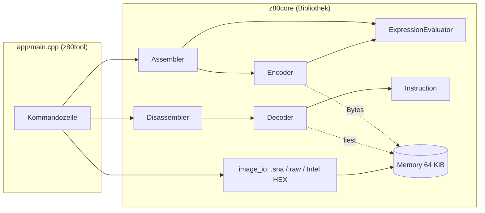

# Architektur

## Überblick

Die Bibliothek `z80core` hat **keine** Konsolenausgabe und keinen globalen Zustand; alle Klassen
sind unabhängige Instanzen. `app/main.cpp` ist die einzige Stelle mit Ein-/Ausgabe auf
Stdin/Stdout und mit Dateinamen. Genau dieser Schnitt macht den späteren Monitor möglich: ein
zweites Frontend benutzt dieselbe Bibliothek.

## Komponenten

| Header (`include/z80/`) | Aufgabe |
|---|---|
| `types.hpp`, `format.hpp`, `version.hpp` | `Byte`/`Word`, Zahlenformatierung (`&1F`, `$1F`, `0x1F`, `1FH`) |
| `memory.hpp` | `Memory`: flacher 64-KiB-Adressraum, Zugriffe laufen bei `0xFFFF` über |
| `instruction.hpp` | `Instruction`: Adresse, Bytes, Mnemonic, Operanden, `FlowKind`, Sprungziel |
| `decoder.hpp` | `decode(memory, address, options)` → ein `Instruction` |
| `disassembler.hpp` | Ablaufanalyse, Querverweise, Kommentare, Ausgabe (`render`) |
| `expression.hpp` | Ausdrucksauswerter (rekursiver Abstieg) |
| `encoder.hpp` | `encodeInstruction(mnemonic, operands, pc, eval)` → Bytes |
| `assembler.hpp` | Zeilenparser, Symboltabelle, Mehrpass, `AssemblyResult` |
| `image_io.hpp` | Dateien lesen/schreiben, `.sna` laden/patchen, Intel HEX |

## Dekoder

Statt einer 256-Einträge-Tabelle je Präfix (wie im BASIC-Original, wo sich dadurch Tippfehler in
der Tabelle einschlichen) zerlegt der Dekoder den Opcode nach dem bekannten Schema
`x = op>>6`, `y = (op>>3)&7`, `z = op&7`, `p = y>>1`, `q = y&1` und setzt Registernamen aus kleinen
Tabellen ein. Das sind rund 400 Zeilen statt mehrerer Hundert Tabellenwerte, und eine ganze
Fehlerklasse (falscher Tabelleneintrag) entfällt.

- `DD`/`FD`: Der Präfix wirkt nur auf die offiziell indizierbaren Opcodes. Bei allen anderen
  Folgebytes ist der Präfix ein einzelnes `DB`, danach wird normal weiterdekodiert.
  `DD CB d op` mit undokumentiertem `op` ist ein vierbytiges `DB`.
- Die Verschiebung `d` steht im Bytestrom **vor** einem unmittelbaren Operanden
  (`DD 36 d n` = `LD (IX+d),n`); der Dekoder liest in dieser Reihenfolge.
- Mit Speicheroperand `(IX+d)` bleiben `H`/`L` echte Register (`LD H,(IX+1)`).
- Undokumentierte Formen (`SLL`, `IN F,(C)`, `ED`-Aliase, `IXH`/`IXL`, …) ergeben `valid == false`.
  So bleibt das Ergebnis immer re-assemblierbar.

## Encoder und Assembler

Der Encoder klassifiziert jeden Operanden (`Reg8`, `Reg16`, `(HL)`, `(IX+d)`, `(nn)`, Ausdruck, …)
und kodiert dann nach Befehlsfamilie. Er bekommt die Ausdrucksauswertung als Callback, kennt also
weder Symbole noch Programmzähler-Logik.

Der Assembler läuft **mehrfach** über den Quelltext:

1. Durchläufe ohne Ausgabe, bis sich die Symboltabelle nicht mehr ändert (höchstens 16;
   typisch 2). Das löst Vorwärtsreferenzen und rückwärts verwendete `EQU`s. Die Befehlslängen
   hängen nie vom Wert eines Symbols ab (Z80!), deshalb konvergiert das immer.
2. Ein letzter Durchlauf erzeugt Bytes, Listing und – erst jetzt – Fehlermeldungen. So gibt es
   keine Scheinfehler aus Zwischenzuständen.

Fehler brechen die Assemblierung nicht ab; Bereichsfehler (`LD A,300`) liefern trotzdem die Bytes
der Zeile, damit alle folgenden Adressen stimmen.

## Disassembler

Zustand: `covered_[65536]` (Byte gehört zu analysiertem Code/Inline-Daten), `isStart_[65536]`
(Byte beginnt einen Befehl), `callers_`/`jumpers_` (Ziel → Menge der Aufrufstellen), Kommentare,
Einstiegspunkte, Inline-Daten-Hooks. Das entspricht `memorymap`, `memorymap2`, `memorymap3` und
der verketteten Liste des BASIC-Originals, nur mit Standardcontainern.

`analyzeFlow(entry)` folgt Wegen (`follow`) mit drei Prioritätsstapeln (Calls, bedingte `JP`,
bedingte `JR`/`DJNZ`) und danach den Einstiegspunkten. Ein Weg endet bei `RET`, `RST`,
`JP (HL)`, bereits analysiertem Code, einer Null-Folge oder dem Rand des Analysebereichs.

`render()` baut zuerst eine Zeilenliste (`buildLines`: Befehle, `DB`-Zeilen, `DS`-Läufe) und
formatiert sie dann als Listing oder als Quelltext. Befehle, die über den Rand des Ausgabebereichs
hinausragen, erscheinen als `DB` – das garantiert die Roundtrip-Eigenschaft
`assemble(render(asm)) == Speicher` (getestet, siehe [testing.md](testing.md)).

## Emulator und Agenten-Schnittstelle

| Header | Aufgabe |
|---|---|
| `cpu.hpp` | `Registers`, `CpuState`, `Cpu` (Ausführung, Breakpoints, Watchpoints, Interrupts, Ports) |
| `snapshot.hpp` | `Snapshot` (CPU + RAM), Datei-Serialisierung, Registerzugriff per Name, JSON-Zustand |
| `json.hpp` | kleiner JSON-Baustein (Parser/Ausgabe, Insertion-Order) |
| `session.hpp` | `Session`: eine Maschine + Symbole, Checkpoints, E/A-Log; `handle(json)` → `json` |

`Cpu` dekodiert nicht über `decode()` (der Dekoder liefert Text, der Emulator braucht Bitfelder und
Taktzahlen), sondern führt Opcodes direkt nach demselben x/y/z-Schema aus (`execMain`, `execCb`,
`execEd`, `execBlock`). Präfixe (`DD`/`FD`) wirken über einen `mode`-Parameter, der `HL`/`H`/`L`/`(HL)`
durch `IX`/`IXH`/`IXL`/`(IX+d)` ersetzt – so entstehen die undokumentierten Befehle ohne eigene Tabelle.

Alle Läufe gehen durch eine Schleife (`Cpu::execute`); `run`, `runUntil`, `runUntilReturn`,
`stepOver` und `stepInstruction` unterscheiden sich nur in der `RunSpec`. `Session` enthält keine
Ein-/Ausgabe und ist deshalb ohne Prozess testbar; `app/main.cpp` verbindet sie mit stdin/stdout.

## Erweiterungspunkte (für den Monitor)

- `decode()` ist zustandslos und kann für „disassembliere ab hier, n Befehle“ direkt verwendet
  werden.
- `encodeInstruction()` kodiert eine einzelne Zeile an einer Adresse – die Grundlage für
  einen interaktiven „assemble hier“-Befehl.
- `Symbolizer` lässt den Dekoder Zieladressen als Namen ausgeben (Symboltabelle des Programms).
- `Memory` ist bewusst einfach; ein Emulator ersetzt/erweitert sie um Bankumschaltung und
  I/O-Hooks (siehe [roadmap.md](roadmap.md)).
